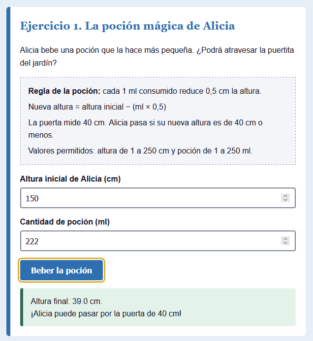
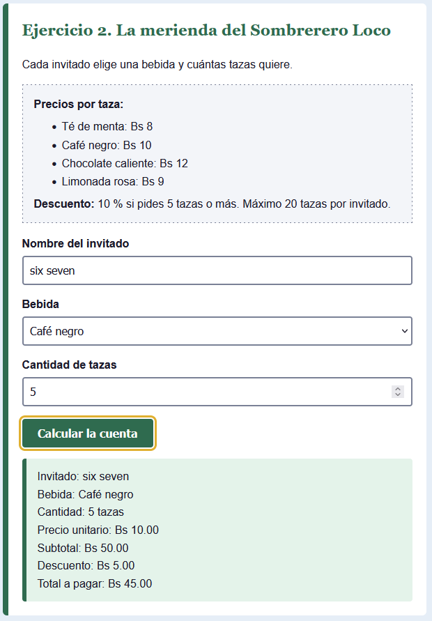
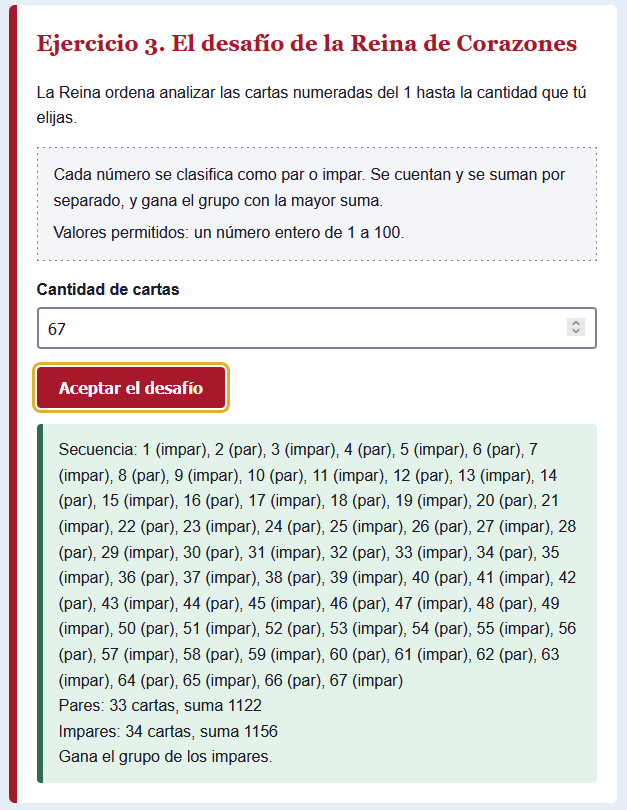

# Alicia en el país de las maravillas

Actividad práctica de **Programación Web I**: tres aplicaciones web con formularios HTML, CSS y JavaScript nativo, inspiradas en la obra de Lewis Carroll.

- **Página publicada:** (https://herikutsuboy.github.io/Pr-ctica-Alicia-en-el-pa-s-de-las-maravillas-byIvanYujra/)
- **Video explicativo:** (https://app.notion.com/p/Video-de-la-explicaci-n-de-los-ejercicios-con-tem-tica-de-Alicia-en-el-pa-s-de-las-maravillas-408dcc34fd95807baf5eddceba1b4291?source=copy_link)

## Ejercicios

| # | Ejercicio | Estructura principal |
|---|-----------|----------------------|
| 1 | La poción mágica de Alicia | Secuencial y condicional (`if`, `else if`, `else`) |
| 2 | La merienda del Sombrerero Loco | Selección múltiple (`switch`) y condicional |
| 3 | El desafío de la Reina de Corazones | Repetitiva (`for`) y condicional |

## Estructura del proyecto

```
alicia-maravillas/
├── index.html                  Página con los tres formularios
├── css/
│   └── estilos.css             Estilos y paleta de colores
├── js/
│   └── app.js                  Lógica de los tres ejercicios
├── docs/
│   ├── explicacion-codigo.md   Explicación del código
│   ├── pruebas.md              Tabla de casos de prueba
│   ├── entrega.md              Enlaces para enviar la entrega
│   └── evidencias/             Capturas de pantalla
└── README.md
```

## Requerimientos cumplidos

- HTML5, CSS3 y JavaScript nativo, sin frameworks ni bibliotecas.
- HTML, CSS y JS en archivos separados.
- Sin Flexbox ni CSS Grid. El diseño usa bloques, anchos máximos y una consulta `@media` para móviles.
- Cada campo tiene su `label` asociada con `for`/`id`, y todo se puede usar con teclado (incluye enlace "Saltar al contenido" y foco visible).
- Eventos `submit` con `addEventListener()` y `preventDefault()`.
- Validación de campos vacíos, rangos, enteros y opciones no válidas.

## Documentación

- [Explicación del código](docs/explicacion-codigo.md)
- [Casos de prueba](docs/pruebas.md)
- [Datos de la entrega](docs/entrega.md)

## Capturas de pantalla





